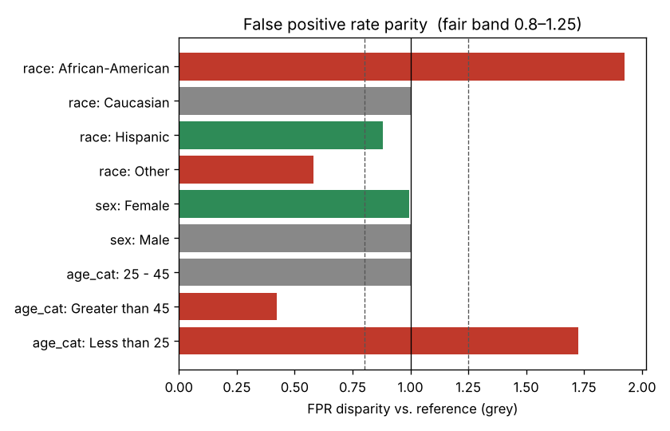

# fairlens

**A bias and fairness audit toolkit for systems that make yes/no decisions about people.**

Give it a table with each person's decision or score, the true outcome, and protected attributes such as race, sex or age. fairlens then:

1. computes confusion-matrix metrics for every group: selection rate, FPR, FNR, precision, FDR, FOR and more;
2. measures **disparities** against a reference group, with **significance tests** (chi-squared, or Fisher's exact test for small cells, Bonferroni-adjusted);
3. gives a **FAIR / UNFAIR verdict** per fairness criterion, using a tolerance τ (default 0.8, the "four-fifths rule");
4. writes a self-contained **HTML report** with charts;
5. offers **mitigation diagnostics**: reweighing as a pre-processing step, and group-specific thresholds as a post-processing step.

The project is inspired by [Aequitas](https://github.com/dssg/aequitas) from UChicago's Data Science for Social Good program. fairlens is a compact, independent implementation of the same audit workflow.



## Quick start

```bash
git clone https://github.com/SAADALKINANI/fairlens.git
cd fairlens
pip install -e ".[dev]"
pytest
python examples/compas_audit.py
```

```python
from fairlens import Audit, load_compas

df = load_compas()   # columns: score (0/1), label_value (0/1), race, sex, age_cat
audit = Audit(df, ["race", "sex", "age_cat"],
              reference={"race": "Caucasian", "sex": "Male", "age_cat": "25 - 45"}).run()

audit.summary()                  # verdict per attribute × fairness criterion
audit.table(("fpr", "fnr"))      # group metrics + disparities
audit.to_html("report.html")     # shareable report
```

Command line:

```bash
fairlens audit decisions.csv --attrs race sex --score score --threshold 0.5 \
                             --ref race=White sex=Male --out report.html
```

## Case study: COMPAS

The example audits ProPublica's Broward County COMPAS data, 6,172 defendants after ProPublica's filters. "Positive" means a COMPAS decile of 5 or higher (medium or high risk), and the outcome is re-arrest within two years. Results:

| | Black defendants | White defendants |
|---|---|---|
| Flagged high-risk (selection rate) | 57.6% | 33.1% |
| **False positive rate**: flagged, but did not re-offend | **42.3%** | **22.0%** |
| **False negative rate**: not flagged, but did re-offend | 28.5% | 49.6% |
| Precision: flagged and did re-offend | 65.0% | 59.5% |

- The FPR disparity is **1.92×** (p ≈ 5×10⁻³⁰), so the score fails *false positive rate parity*.
- Precision is within tolerance, so it passes *predictive parity*. This was Northpointe's defence of the tool.
- Both findings are true at once. When base rates differ between groups, a classifier generally **cannot** satisfy error-rate parity and predictive parity together (Chouldechova 2017; Kleinberg et al. 2016). An audit doesn't decide which one matters. It makes the trade-off visible so that the people accountable for the system can choose.
- The mitigation diagnostic shows that a decile cut-off of 7 for Black defendants (vs 5 for white defendants) would equalise FPR. Using race-specific thresholds raises its own legal and ethical problems, which is why fairlens frames this as a diagnostic, not a fix.

A full report from this run is at [`docs/compas_report.html`](docs/compas_report.html).

## Metrics

| Metric | Formula | Question it answers |
|---|---|---|
| `pprev` | PP / n | How often is this group flagged? |
| `ppr` | PP_g / PP_total | What share of all flags go to this group? |
| `fpr` | FP / (FP+TN) | How often are negative people wrongly flagged? |
| `fnr` | FN / (FN+TP) | How often are positive people missed? |
| `precision` | TP / PP | Does a flag mean the same thing for everyone? |
| `fdr`, `for` | FP / PP, FN / PN | How often are flags / non-flags wrong? |

**Which criterion should you use?** It depends on where the harm lands. If being flagged is punitive (detention, fraud investigation), focus on **FPR** and **FDR**. If being flagged is assistive (outreach, benefits), focus on **FNR** and **FOR**. If you need equal representation, use **pprev** or **ppr**.

## Project layout

```
fairlens/
  metrics.py     confusion counts and group metrics
  disparity.py   reference groups, disparities, p-values, fairness verdicts
  audit.py       Audit class, plots, HTML report
  mitigation.py  reweighing, group thresholds
  datasets.py    COMPAS loader (downloaded on demand), synthetic lending data
  cli.py         command line
examples/compas_audit.py
tests/
```

## Data

The COMPAS data is downloaded at runtime from [ProPublica's compas-analysis repository](https://github.com/propublica/compas-analysis) and is not redistributed here. `make_lending_data()` generates synthetic data with a tunable bias knob for testing.

## License

Apache 2.0
